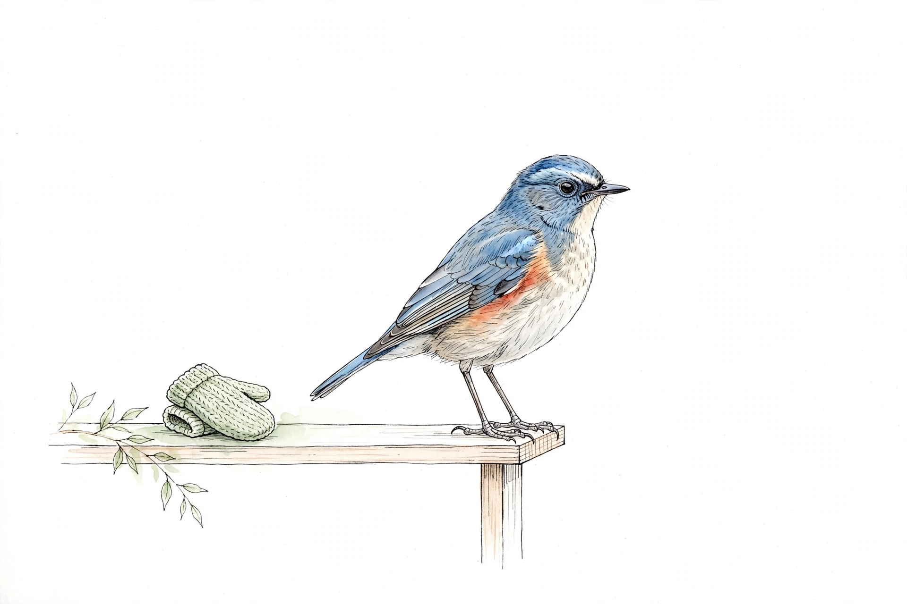

# Solo 実例集（叩き台）

キットの作者の個人開発（-Solo シリーズ）から、「どんな困ったことが、どんな作品になったか」を分解したものです。考えるきっかけとして使ってください。

## VS Code 拡張

| 作品 | 困ったこと | 実物へのリンク |
|---|---|---|
| MeetDock-Solo | 会議の予定と資料を行き来する手間 | [Marketplace](https://marketplace.visualstudio.com/items?itemName=masanori-satake.meetdock-solo) / [Open VSX](https://open-vsx.org/extension/masanori-satake/meetdock-solo) / [GitHub](https://github.com/masanori-satake/MeetDock-Solo) |
| StructMap-Solo | コードの構造を頭の中だけで追う大変さ | [Marketplace](https://marketplace.visualstudio.com/items?itemName=masanori-satake.structmap-solo) / [Open VSX](https://open-vsx.org/extension/masanori-satake/structmap-solo) / [GitHub](https://github.com/masanori-satake/StructMap-Solo) |
| SkillMap-Solo | スキルのファイル同士のつながりが見えない | [Marketplace](https://marketplace.visualstudio.com/items?itemName=masanori-satake.skillmap-solo) / [Open VSX](https://open-vsx.org/extension/masanori-satake/skillmap-solo) / [GitHub](https://github.com/masanori-satake/SkillMap-Solo) |
| SkillTrace-Solo | AI がスキルを実際にどこまで読んだのか、実行してみないと分からない | [Marketplace](https://marketplace.visualstudio.com/items?itemName=masanori-satake.skilltrace-solo) / [Open VSX](https://open-vsx.org/extension/masanori-satake/skilltrace-solo) / [GitHub](https://github.com/masanori-satake/SkillTrace-Solo) |

## Chrome 拡張

| 作品 | 困ったこと | 実物へのリンク |
|---|---|---|
| QuickLog-Solo | 作業の記録を付けるのが面倒で、後から「何をしていたか」を思い出せない | [Chrome Web Store](https://chromewebstore.google.com/detail/kllhfalcincleolgoepnailfjendigdh) / [GitHub](https://github.com/masanori-satake/QuickLog-Solo) |
| Replace-Solo | 議事録などの文章で、同じ置き換えを何度も手作業で繰り返す手間 | [Chrome Web Store](https://chromewebstore.google.com/detail/replace-solo/iblfnonogpkajjfjfljngdaclhdinlfb) / [GitHub](https://github.com/masanori-satake/Replace-Solo) |
| OmniView-Solo | Web 会議でホワイトボードや資料をカメラに映すと見づらい | [Chrome Web Store](https://chromewebstore.google.com/detail/omniview-solo/jnkmbcicplfobgllfljekhlaofkdooam) / [GitHub](https://github.com/masanori-satake/OmniView-Solo) |
| TabMagnet-Solo | 開きすぎたタブが散らかって、目的のタブが見つからない | [Chrome Web Store](https://chromewebstore.google.com/detail/tabmagnet-solo/lffgddghjafcjpfjdpknhfbonhnkdlmc) / [GitHub](https://github.com/masanori-satake/TabMagnet-Solo) |
| FlexPaste-Solo | コピーした文章を貼り付けるとき、整形を毎回手でやる手間 | [Chrome Web Store](https://chromewebstore.google.com/detail/egmememialdjhohecnfkimpablkjfabg) / [GitHub](https://github.com/masanori-satake/FlexPaste-Solo) |
| ActionsBoard-Solo | GitHub Actions の実行状態を確認するために、何度もページを見に行く手間 | [Chrome Web Store](https://chromewebstore.google.com/detail/oofegjdjnldkikigimkadlleaiolionm) / [GitHub](https://github.com/masanori-satake/ActionsBoard-Solo) |
| Issues-Solo | Jira のチケットをタブで開いていると、どこに行ったか分からなくなり、探し直すのに時間がかかる | [Chrome Web Store](https://chromewebstore.google.com/detail/cehkajdhieihmoghbneckifpkoafmbco) / [GitHub](https://github.com/masanori-satake/Issues-Solo) |

Chrome 拡張は、Chrome Web Store の公開枠の関係で、公開中の7本だけを載せています。

共通点は「既存の作業の流れの中の、困ったことを1つだけ取り除く」ことです。大きな仕組みは作っていません。
