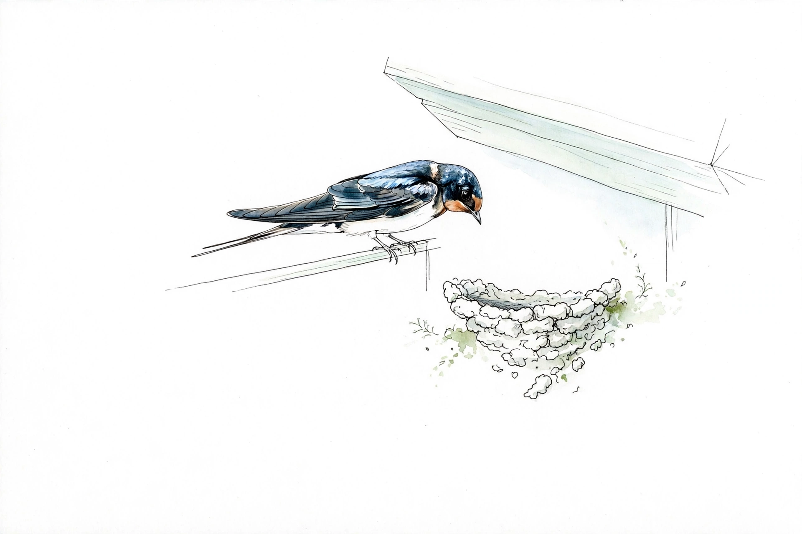

# 型カタログ

作れる作品は次の3型のどれかです。型ごとに「できること・できないこと」が決まっていて、これがガードの第1層（対話ガード）の根拠になります。
どの型も共通で: 外部への通信はしない／使うデータは自分のパソコン（ワークスペースとエディタ）の中だけ／キット同梱以外の部品は足さない（依存ゼロ）。

## コマンド型

- 姿: 呼ばれた時だけ動く一発の操作。コマンドパレットやショートカットから実行する
- できること: 今開いている文書や選んだ文字を変換する、決まった文を挿入する、ファイルを作る・書き出す（書き出し先はワークスペース内のみ）、情報をクリップボードへコピーする
- できないこと: 常に表示し続けること、バックグラウンドで動き続けること
- テンプレート: `templates/command/`
- 体験会お題: 自分の定型句ワンタッチ挿入

## 表示型

- 姿: 下の帯（ステータスバー）などに常に小さく出続ける表示
- できること: 今開いているファイルやフォルダから数えた数・短い文字を常時表示し、編集に合わせて更新する。クリックでコマンドを呼ぶこともできる
- できないこと: 大きな画面を出すこと、複雑な操作を受け付けること
- テンプレート: `templates/display/`
- 体験会お題: 自分のマーカー残数

## パネル型

- 姿: サイドや下部に開く大きめの表示画面。キット側の器（レイアウトテンプレート）から選ぶ
- できること: ローカルのデータ（ファイルの中身、設定、作品内のデータ）をカード／一覧／タイムライン等の器に並べて眺める
- できないこと: パネルからの本格的な編集や外部データの取得。器そのものの新規開発
- テンプレート: `templates/showcase/`
- 体験会お題: 自分専用チートシート
