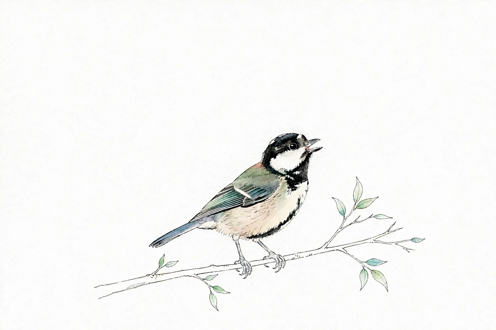

# トラブルシュート／FAQ

<p align="center"><a href="../assets/birds.md"></a></p>

作業中に困ったら、まず AI のチャット欄に次の文をそのまま入力してください。問い合わせの多い質問は、この下にまとめています。

```
my-vsix-help スキルで進めて
```

## 準備・セットアップ

- **Q: pre-commit の初回実行が終わらない** — 初回は Node.js や vsce などのダウンロードがあります。プロキシのあるネットワーク経由だと失敗することがあります。時間を置いて再実行し、それでもダメなら15分を超える前に次のサポートへ相談してください
- **Q: `FatalError: git failed` と表示される** — キットを ZIP でダウンロードしていると、この表示になります。git clone でコピーし直してください（ビルドの仕組みは git の管理下で動きます）
- **Q: スキルが認識されない** — フォルダを開き直す／AI ツールを再起動する。セットアップの機械展開が終わっているか、my-vsix-setup で確認できます
- **Q: スキルが動いているのか分からない** — スキルが選ばれていると、声かけへの返事が作業の段取りから始まります（例: セットアップなら、環境の確認をして制作メモを作る流れになる）。一般的な説明文だけが返ってきた場合は、スキルが選ばれていません。開いているフォルダがリポジトリのルートかどうかを確認して、声かけ文をもう一度そのまま入力してください

## ビルド

- **Q: ガードで止まった** — 何がいけなかったのかが、やさしい言葉で表示されます。直し方は AI が代替案と一緒に出します。作品の側を直すのが基本で、ガードを外すことはしません

## 考え方

- トラブルシュートが **15分を超えそう、または同じ試行が3回以上に及びそう** になったら、次の段のサポート（利用者同士の場 → キットの Issue）に頼るのが、このキットの約束です

## 仕組みが気になったら

- **Q: 裏で何が動いていたのか知りたい** — 工程ごとにカラクリを明かした文書があります: [Inside My VSIX — カラクリの話](inside.md)。作り終わった人向けのタネ明かしなので、最初に読む必要はありません
