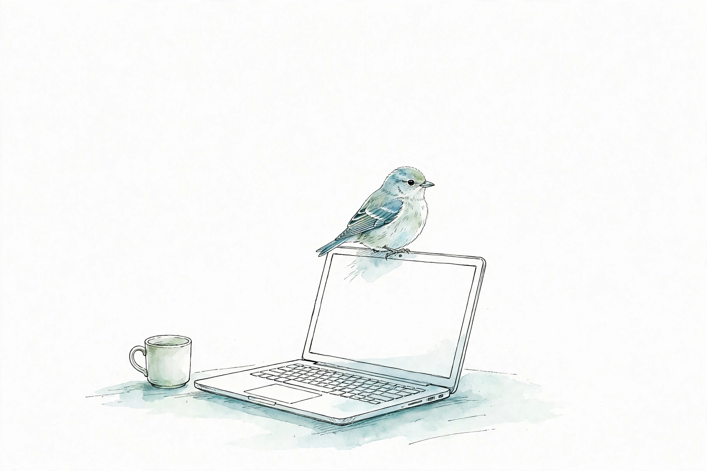

# はじめ方ガイド

<p align="center"><a href="../assets/birds.md"></a></p>

1. このリポジトリを **git clone** で自分のパソコンにコピーする（GitHub の画面からの ZIP ダウンロードでは、ビルドの仕組みが動きません）
2. [事前準備ガイド](pre-setup-guide.md) の事前準備を済ませる
3. このフォルダ（リポジトリのルート。中にあるフォルダではなく、このフォルダ自体）を VS Code（または Kiro）で開く
4. AI（Copilot／Kiro）のチャット欄に、次の文をそのまま入力する

   ```
   my-vsix-setup スキルで進めて
   ```

セットアップが終わったら、作り始めます。体験会に参加する場合は、次の文をチャット欄に貼ってください。

```
my-vsix-workshop スキルで進めて
```

自分で作る場合は、こちらの文を貼って開始します。

```
my-vsix-problem スキルで進めて
```
