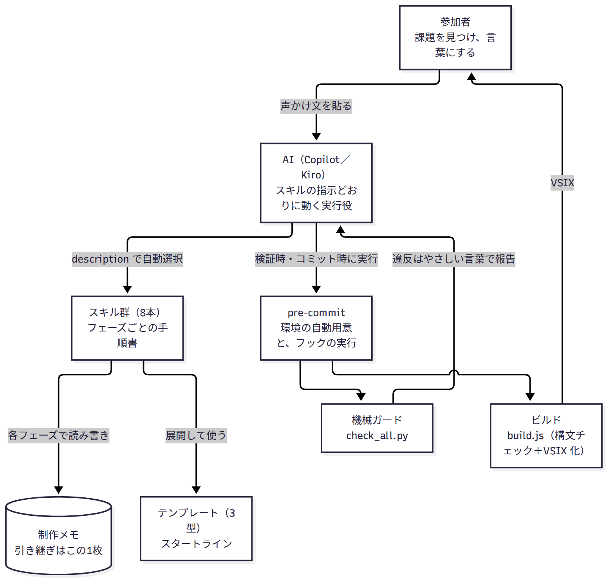
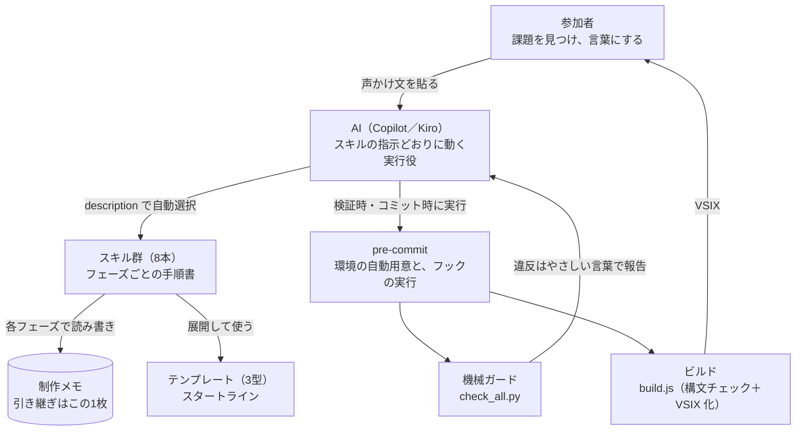
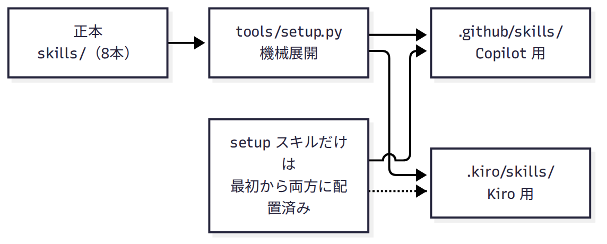
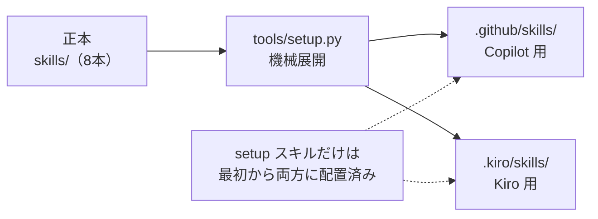
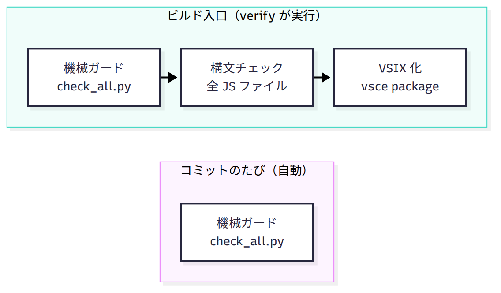
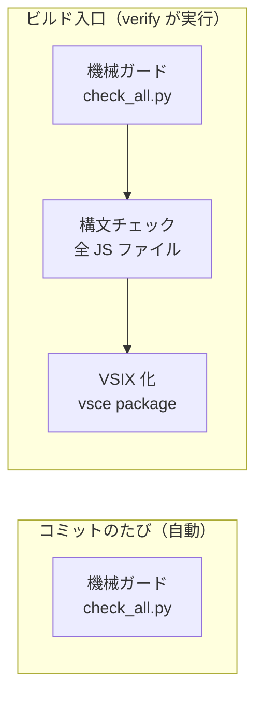
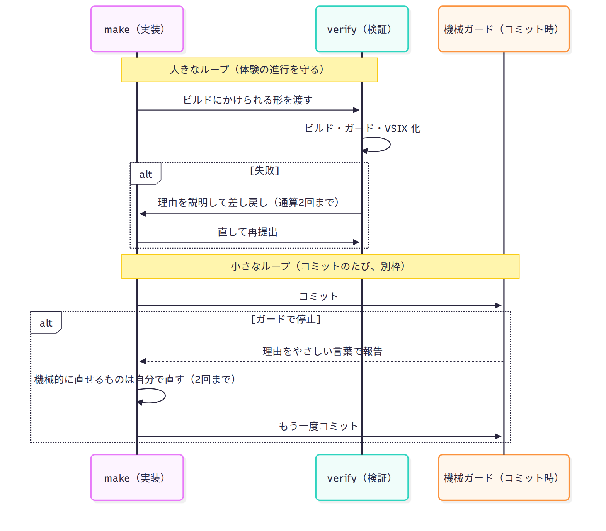
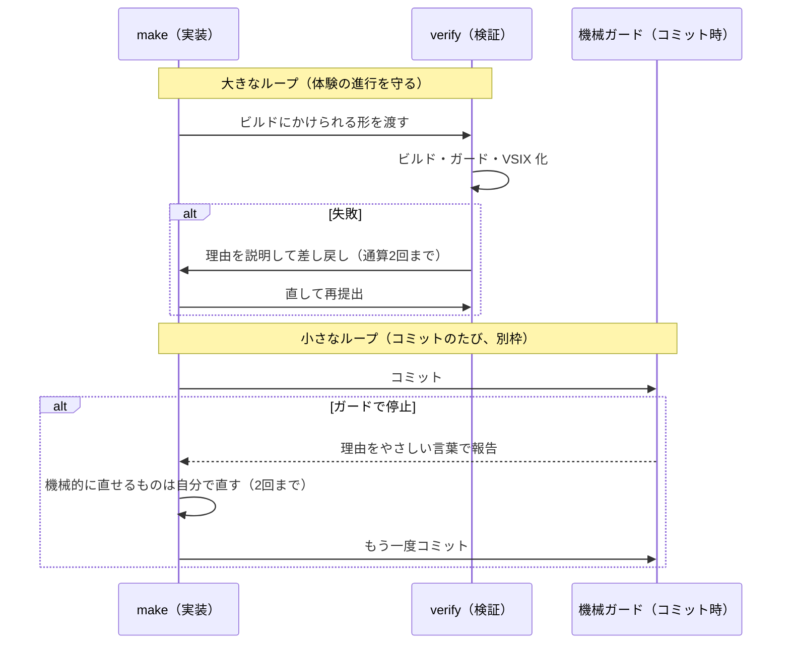
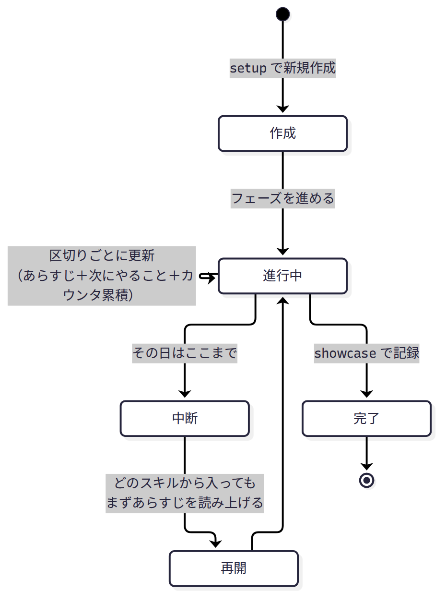
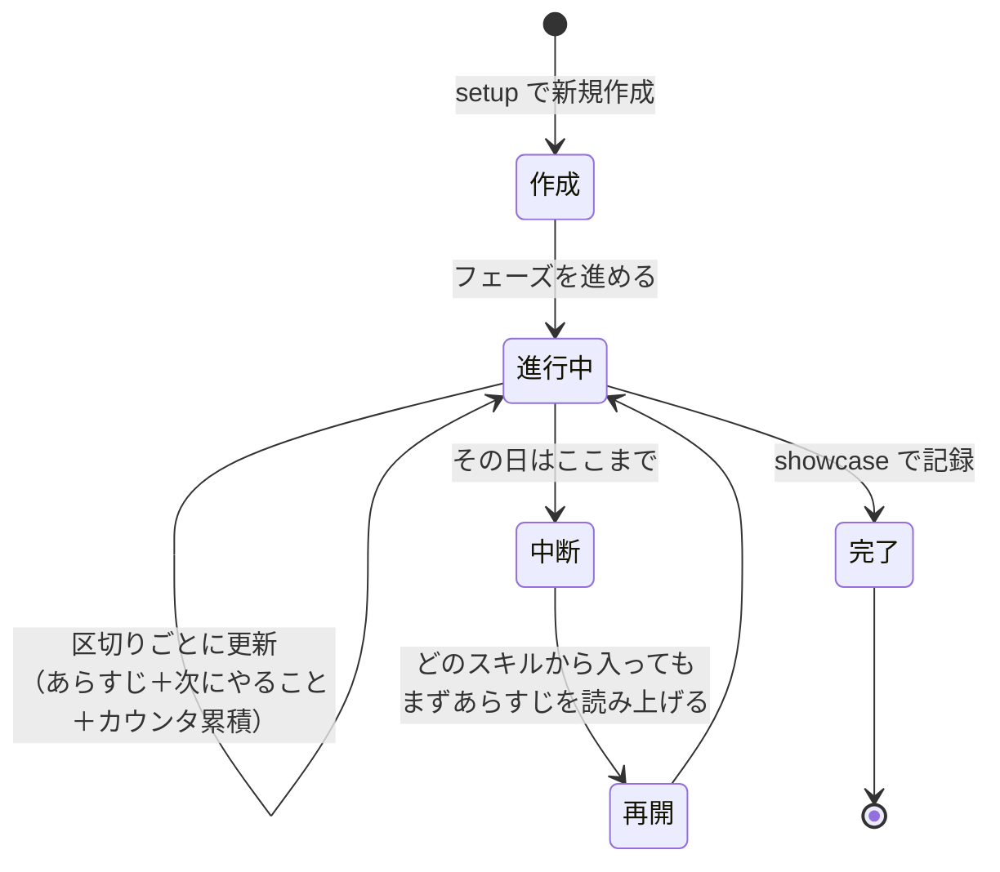

# Inside My VSIX — カラクリの話

この文書は、キットを最後まで使った人向けの「タネ明かし」です。作っている最中に読むものではありません。工程の裏で、スキルとスクリプトが何をしていたかが気になったら、どうぞ。

このキットでは、技術は意図的に表に出さない設計にしていました。理由は最後の節に書きます。ここではまず、工程ごとにカラクリを明かします。

## 全体像

参加者・AI・スキル・スクリプトの関係はこうなっています。

図の元データ（Mermaid）

ポイントは、AI が勝手に進めていたわけではないことです。AI は、その場面のスキルの指示どおりに動く実行役でした。段取りはスキルに書かれていて、状態は制作メモに残っていました。

なお、この文書の図はすべて、画像（PNG）の下に図の元データ（Mermaid 記法）を折りたたんで置いてあります。配布先の環境によっては記法のままでは図として表示されないためで、直したいときは折りたたみを開いてください。

## 工程ごとのタネ明かし

### 声かけ文を貼るだけで始まった理由

貼った文（「my-vsix-setup スキルで進めて」）は、実はコマンドではありません。各スキルは `description`（どんなときに使うかの説明文）を持っていて、AI が会話の内容と照らして自動で選びます。声かけ文は、その選択を確実にするための「合図」です。スラッシュコマンドのような専用の仕組みは使っていません。

### setup: スキルが最初から読めた理由

skills の正本は `skills/` にありますが、通常は `tools/setup.py` が Copilot 用（`.github/skills/`）と Kiro 用（`.kiro/skills/`）へ機械展開します。ただ、展開を実行する setup スキル自身は、展開前の時点でも読めなければ困ります。そこで setup だけは最初から両方の置き場に同梱して配る、という例外にしています。

図の元データ（Mermaid）

環境の棚卸しやバージョン確認も、スキルが1ステップずつ案内していたものです。「AI が気を利かせた」のではなく、手順が書いてあった、というのが正確なところです。

### problem / shape: 技術の話が出てこなかった理由

problem スキルは「技術の話を一切しない」ことが指示に書かれています。shape スキルは、参加者の日常語を、裏側の対訳表（`assets/term-bridge.md`）で専門用語と型に翻訳していました。画面の場所を指すときの言葉も、画面マップ（`assets/screen-map.md`）の日常語が正で、専門用語は決定後に一度だけ括弧で添える決まりでした。

### make: テンプレートと、プレビューで直した理由

テンプレートは「檻」ではなくスタートラインです。固定しているのは、ガードの不変条件（通信なし、依存ゼロ、API 許可リスト、バージョンのピン留め）と骨格の最小の約束だけ。実機に入れずプレビューで直してもらっていたのは、ビルドを伴わない往復のほうが速くて安いからです。

### verify: 止まった理由と、直って戻ってきた理由

検証時に走っていたのは、pre-commit の2つのフックです。

図の元データ（Mermaid）

機械ガードの中身は正規表現のパターン検査です。秘密情報らしき文字列、外部通信（fetch、http モジュール等）、シェル実行（child_process 等）、ワークスペース外への参照を検出し、違反は技術用語ではなくやさしい言葉の文で報告します。あわせて package.json の決まり（部品を追加していないか、対象バージョンの指定があるか）も見ています。

「禁止事項リスト」ではなく、型の側に「できることの範囲」しか用意しない作りなのもポイントです。外部送信は、禁止されているからできないのではなく、型の中に存在しないので作れません。機械ガードは、その抜け道を塞ぐ第2層です。

そして今回のキットから、コミットのたびにも機械ガードが自動で走るようになりました。止まったら、エージェントが理由を読んで、機械的に直せるもの（構文ミス、混ざった禁止パターン）は自分で直し、もう一度コミットするところまでを回します。人に渡すのは、意味が変わる直しや、約束そのものに関わるものだけ。make と verify の往復（通算2回まで）とは別枠の、小さな自己修正ループです。

2つのループの違いは、時系列で見ると分かりやすくなります。

図の元データ（Mermaid）

大きなループには参加者の体験（時間と「動いた」感覚）がかかっているので、回数で打ち切って仕切り直します。小さなループは機械的な直しだけが対象なので、人の手を止めずに回し切ります。

### 制作メモ: 「前回の続き」ができた理由

中断しても続きから始められたのは、AI が覚えていたからではありません。状態はすべて制作メモという1枚のファイルにあり、各スキルは始める時に読み、区切りごとに書き直していました。

図の元データ（Mermaid）

だから、別の日に開いても、別のスキルから入っても、同じ場所に戻ってこられました。記憶の置き場が「AI の中」ではなく「ファイル」だった、というのがタネです。

### showcase / help: 締めにも段取りがあった

作品台帳への追記、「いつかリスト」を1つだけ見せること、トラブルシュートの打ち切り（15分、または同じ試行3回で次の相談先へ）も、全部スキルの指示です。特に打ち切りは「開催者に質問が集中して開催者がボトルネックになる」のを防ぐためで、サポートを3段（FAQ で自己解決 → 利用者同士の場 → キットの不具合だけ作者へ）に分けた設計とセットになっています。

## なぜ技術を隠したか

理由は2つあります。

1つ目は、集中のためです。体験の目的は「課題を見つけ、どう解決できるかを考え、それを言語化する」ことでした。技術の段取りが表に出ると、そちらに注意が取られて、本来考えるべきことが後回しになります。だから技術はスキルの裏に隠し、参加者は作ることだけに注力できるようにしました。

2つ目は、この文書で一番伝えたいことです。このキットで体験した「詳しい人に聞かなくても、誰でも同じ段取りで進められる」という状態は、ノウハウをシステム化した結果です。

ノウハウをドキュメントに書いて渡すだけだと、読む人によって解釈が違い、理解するまでにかかる時間も違い、結局は「詳しい特定の人」に質問が戻ってきます。属人化です。一方でノウハウを、手順（スキル）、機械チェック（ガード）、状態の引き継ぎ（制作メモ）という形でシステムに埋め込むと、解釈の余地が減り、誰が使っても同じ品質で回り、次の人にそのまま渡せます。

皆さんのプロジェクトにも、「あの人に聞かないと分からない」ことはあるはずです。そのノウハウは、ドキュメントに書くだけでなく、システム化して渡せないでしょうか。このキットのスキルとガードの実物は、すべてこのリポジトリの中にあります。小さい実例として、読みに来てください。

## 実物への案内

- スキル8本の実物: `skills/`（各フォルダの `SKILL.md` が手順書そのもの）
- 機械ガード: `tools/guards/check_all.py`
- ビルド: `tools/build/build.js`
- スキルの機械展開: `tools/setup.py`
- バージョンの固定値と根拠: `docs/version-pins.md`
